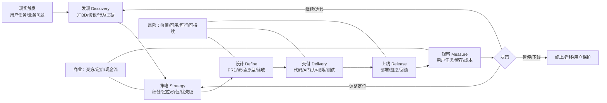
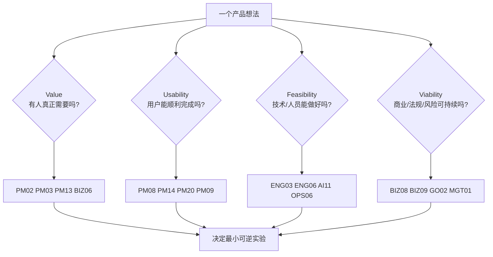
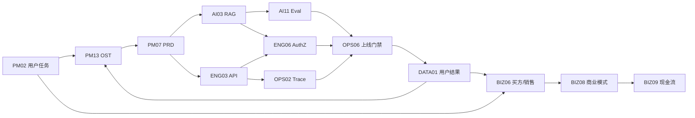
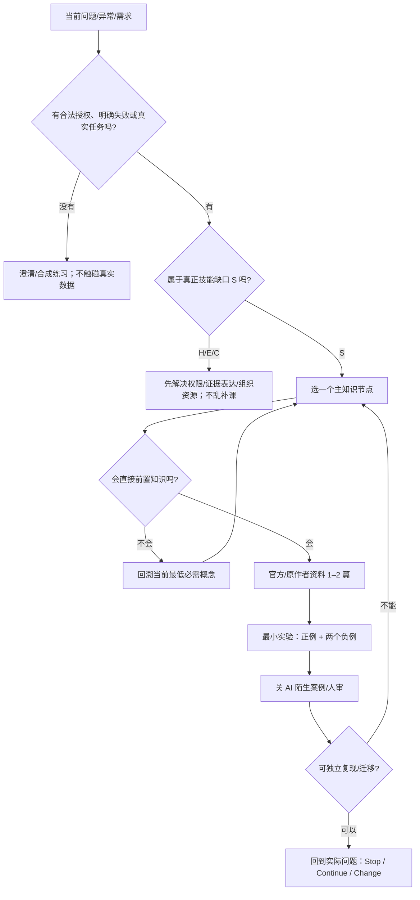

# 产品经理完整知识关系图（可在 GitHub 渲染）

> **画的是因果关系与协作闭环，不是学习/开发必须严格发生的顺序**。如果你今天卡在定价，就从定价向相关节点回溯；如果卡在越权，就从安全回溯。比喻与术语参照 [专业×大白话](product-manager-primer.md)。

## 1. 一张图看完整产品生命周期：从用户问题到回访

**大白话**：开餐馆不是照着“找菜、装修、开业”做一次就结束，顾客反馈会让你改菜、改服务或关掉不挣钱的菜品。

## 2. 四类风险决定该查哪些知识

**专业来源**：[SVPG 产品四风险与 discovery](https://www.svpg.com/product-management-an-introduction/)。四种风险可以同时调查，不是先价值再体验再技术的强制排队。

## 3. 知识网络：同一能力怎样支持多个业务问题

**大白话**：权限不是“安全课独立的一门”，它会直接影响 AI 检索、SaaS 支付、客户合同和能否真正上线；学会一次可迁移到很多场景。

## 4. 需求驱动学习的实际决策树

## 图之外要记住什么

**时间不是能力证明**，知识树也不自动代表“掌握”；需要 [本人的实际考核](../../12-Assessments/rubric.md)。生产上线用 [G0–G7](../launch/production-readiness.md) 复核，商业证据只回事实权威仓。更细的知识项/官方资料/上游私仓路径见 [完整知识手册](knowledge-handbook.md)。
